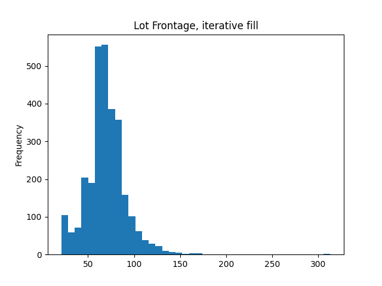

# HW5 report

## 1 Provenance
## 2 Validation: failures on the raw file
## 3 Sentinels and structural absence
## 4 Keys and duplicates
## 5 Missingness mechanism
Missing: 490 of 2,930 houses (16.7)

| Compare | Value present | Value missing |
| --- | --- | --- |
| Mean Lot Area | 9,710 | 12,331 |
| Mean Year Built | 1,971 | 1,976 |
| Mean Gr Liv Area | 1,489 | 1,553 |
| Mean SalePrice | 180,100 | 184,263 |

Share missing by Lot Config: CulDSac 0.489, Corner 0.204, Inside 0.128.
Share missing by Lot Shape: Reg 0.071, IR1 0.332.

Mechanism: MAR.

Evidence: Clear difference on observed columns → not MCAR. Cul-de-sac lots are missing 49% of the time, inside lots 13%. Regular lots 7%, irregular (IR1) lots 33%. Argue MAR with domain knowledge.

What the data cannot tell me: MAR versus MNAR cannot be tested from the data. The evidence would sit in the values that are missing.

Column picked: Mas Vnr Area

Missing: 23 of 2,930 houses (0.8
)
| Compare | Value present | Value missing |
| --- | --- | --- |
| Mean Lot Area | 10,141 | 10,984 |
| Mean Year Built | 1,971 | 2,003 |
| Mean Gr Liv Area | 1,498 | 1,662 |
| Mean SalePrice | 180,380 | 233,349 |
Share missing by Sale Condition: Partial 0.045, Normal 0.005, Alloca 0.042.

Mechanism: MAR

Evidence: Clear difference on observed columns → not MCAR. Houses missing Mas Vnr Area are much newer (2003 against 1971) and cost more. Partial sales are missing nine times as often as Normal sales. Partial means the home was not complete at last assessment (data dictionary). Argue MAR with domain knowledge.

What the data cannot tell me: Only 23 houses are missing, so the shares are noisy. MAR versus MNAR cannot be tested from the data. The evidence would sit in the values that are missing.

Question: If Lot Frontage were MNAR, the missing value would be the reason it is missing. A cul-de-sac lot has a short, curved edge on the street, so its frontage is hard to measure, and the assessor may leave very small or odd values blank. Then the houses with the strangest frontage would be the ones missing, and the evidence would sit in those missing values, so no observed column could show it.

## 6 Imputation strategy and defense (at most 150 words)
| Strategy | std before | std after | corr with Lot Area before | corr with Lot Area after |
| --- | --- | --- | --- | --- |
| Median (68.0) | 23.4 | 21.3 | 0.49 | 0.36 |
| Iterative (uses other columns) | 23.4 | 22.8 | 0.49 | 0.57 |

The median fill creates a spike at 68, where 490 houses now share one value. The iterative fill spreads the filled values out, so the shape stays closer to the observed data.

I choose the iterative fill. In Part 5, Lot Frontage looked MAR. it is missing more often for cul-de-sac and irregular lots and for larger lots, and all of these are observed. Under MAR, the variables that predict missingness belong in the imputation model. The iterative fill uses Lot Area, living area, year built and quality, so the filled values depend on what predicts the gaps. The median fill ignores them. It gives all 490 houses the value 68, and it shrinks the std from 23.4 to 21.3. The iterative fill keeps the std at 22.8. Its cost is that the correlation with Lot Area rises from 0.49 to 0.57, because fills sit on the line with no noise. It also does not use Lot Config, which is categorical. If the data were MNAR, neither fill would fix it.
## 7 Leakage-safe evaluation
## 8 What this data cannot tell you
