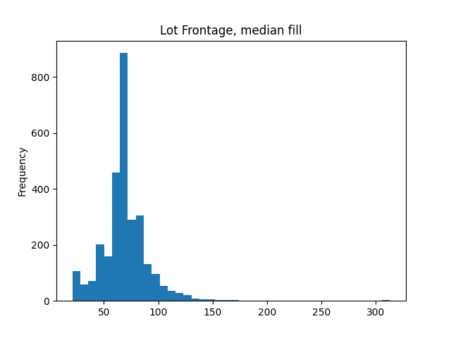

# HW5 report

## 1 Provenance

I downloaded the Ames Housing data from https://jse.amstat.org/v19n3/decock/AmesHousing.txt on 2026-11-21 (De Cock, 2011). The terms say it is free to be used in teaching if cited. The file had 2,930 rows and 82 columns on arrival.

## 2 Validation: failures on the raw file

| Check | Column | Failures | What I did |
|---|---|---|---|
| Value outside range | Garage Yr Blt | 1 | Set the value to missing. It was outside 1850 to 2010. |
| Code not in dictionary | MS Zoning | 29 | Changed to the dictionary codes (A, C, I). |
| Code not in dictionary | Bldg Type | 272 | Changed to the dictionary codes (2FmCon, Duplx, TwnhsI). TwnhsI is my inference. |
| Code not in dictionary | Neighborhood | 443 | Changed NAmes to Names. |
| Cross-column | Year Remod/Add before Year Built | 1 | Set the remodel year to missing. The true value is unknown. |

## 3 Sentinels and structural absence

| Column | Rows with "NA" | Dictionary says |
|---|---|---|
| Alley | 2732 | no alley access |
| Bsmt Qual | 79 | no basement |
| Bsmt Cond | 79 | no basement |
| Bsmt Exposure | 79 | no basement |
| BsmtFin Type 1 | 79 | no basement |
| BsmtFin Type 2 | 79 | no basement |
| Fireplace Qu | 1422 | no fireplace |
| Garage Type | 157 | no garage |
| Garage Finish | 157 | no garage |
| Garage Qual | 158 | no garage (157 rows); unknown (1 row) |
| Garage Cond | 158 | no garage (157 rows); unknown (1 row) |
| Pool QC | 2917 | no pool |
| Fence | 2358 | no fence |
| Misc Feature | 2824 | none |

| Column | Zeros | Sentinel |
|---|---|---|
| Garage Area | 157 | No. A house with no garage has 0 sq ft. All 157 match Garage Type NA. |
| Pool Area | 2917 | No. A house with no pool has 0 sq ft of pool. All 2917 match Pool QC NA. |
| Fireplaces | 1422 | No. 0 is the count of fireplaces. All 1422 match Fireplace Qu NA. |
| Total Bsmt SF | 79 | No. A house with no basement has 0 sq ft. All 79 match Bsmt Qual NA. |
| Misc Val | 2827 | No. 0 is the dollar value of the misc feature. 2824 match Misc Feature NA. The other 3 have a feature worth $0. |

I treat "NA" as none only where a numeric column says the feature is absent (for example Garage Area is 0). Everywhere else I treat it as unknown and set it to missing. I keep none as an explicit category.

Garage Qual and Garage Cond have 158 instead of 157. One house (Order 1357) has a detached garage of 360 sq ft but "NA" for quality and condition. That contradicts the dictionary, so `clean.py` sets those two values to missing.

pandas also turned "None" into missing in Mas Vnr Type (1752 rows). The dictionary says "None" means no masonry veneer. It is a real category, not missing.

## 4 Keys and duplicates

I tested two candidate keys. `Order` is unique in all 2930 rows. `PID` is also unique in all 2930 rows.

`Order` is the row number in the file. It identifies one row. `PID` is the parcel ID. It identifies one property. I chose `Order` as the key for one sale.

| Check | Count |
|---|---|
| Exact copies | 0 |
| Same key (`Order`) | 0 |
| Same key (`PID`) | 0 |

I built a lookup table with one row per Neighborhood and its full name from the dictionary. I joined it to the sales with `pd.merge(..., validate="many_to_one")`.

| Step | Rows |
|---|---|
| Sales before the join | 2930 |
| Sales after the join | 2930 |
| Unmatched Neighborhoods | 0 |

The row count did not change. `validate=` raises an error if a key repeats, so the row count cannot change without me knowing.

## 5 Missingness mechanism

Missing: 490 of 2,930 houses (16.7%)

| Compare | Value present | Value missing |
| --- | --- | --- |
| Mean Lot Area | 9,710 | 12,331 |
| Mean Year Built | 1,971 | 1,976 |
| Mean Gr Liv Area | 1,489 | 1,553 |
| Mean SalePrice | 180,100 | 184,263 |

Share missing by Lot Config: CulDSac 0.489, Corner 0.204, Inside 0.128.
Share missing by Lot Shape: Reg 0.071, IR1 0.332.

Mechanism: MAR.

Evidence: Clear difference on observed columns → not MCAR. Cul-de-sac lots are missing 49% of the time, inside lots 13%. Regular lots 7%, irregular (IR1) lots 33%.

What the data cannot tell me: MAR versus MNAR cannot be tested from the data. The evidence would sit in the values that are missing.

Column picked: Mas Vnr Area

Missing: 23 of 2,930 houses (0.8%)

| Compare | Value present | Value missing |
| --- | --- | --- |
| Mean Lot Area | 10,141 | 10,984 |
| Mean Year Built | 1,971 | 2,003 |
| Mean Gr Liv Area | 1,498 | 1,662 |
| Mean SalePrice | 180,380 | 233,349 |

Share missing by Sale Condition: Partial 0.045, Normal 0.005, Alloca 0.042.

Mechanism: MAR

Evidence: Clear difference on observed columns → not MCAR. Houses missing Mas Vnr Area are newer (2003 against 1971) and cost more. Partial sales are missing nine times as often as Normal sales. Partial means the home was not complete at last assessment (data dictionary).

What the data cannot tell me: Only 23 houses are missing, so the shares are noisy. MAR versus MNAR cannot be tested from the data. The evidence would sit in the values that are missing.

If Lot Frontage were MNAR, the missing value would be the reason it is missing. A cul-de-sac lot has a short, curved edge on the street, so its frontage is hard to measure, and the assessor may leave very small or odd values blank. Then the houses with odd frontage would be the ones missing, and the evidence would sit in those missing values, so no observed column could show it.

## 6 Imputation strategy and defense (at most 150 words)

| Strategy | std before | std after | corr with Lot Area before | corr with Lot Area after |
| --- | --- | --- | --- | --- |
| Median (68.0) | 23.4 | 21.3 | 0.49 | 0.36 |
| Iterative (uses other columns) | 23.4 | 22.8 | 0.49 | 0.57 |

The median fill creates a spike at 68. The iterative fill spreads the filled values out.

I choose the iterative fill. In Part 5, Lot Frontage looked MAR. It is missing more often for cul-de-sac lots, irregular lots and larger lots. Under MAR, the variables that predict missingness belong in the imputation model. The iterative fill uses Lot Area, living area, year built and quality. The filled values depend on what predicts the gaps. The median fill ignores that. It gives all 490 houses the value 68 and shortens the std from 23.4 to 21.3. The iterative fill keeps the std at 22.8. The correlation with Lot Area goes up from 0.49 to 0.57, because fills sit on the line with no noise. It does not use Lot Config because that column is categorical.

## 7 Leakage-safe evaluation

Features: the nine columns listed in the README. Only Lot Frontage has missing values (490).

| Variant | Fill | RMSE |
| --- | --- | --- |
| A | median Lot Frontage within SalePrice quintiles, full table | 0.1620 |
| B | iterative fill on the full table, before CV | 0.1621 |
| C | iterative fill inside a Pipeline | 0.1622 |

(2930, 9) 490
A 0.162
B 0.1621
C 0.1622

**Which gives correct values?** C. An imputer is a fitted model. It learns from training rows only. In C the imputer sits inside the pipeline, so cross-validation refits it per fold and the test fold never informs its own fill.

**Which leaks, and how?**
- A is target leakage: the fill uses the label. The filled value encodes the answer. Here the label is SalePrice.
- B is contamination: the fill uses test rows. The imputer was fitted on the full table before the split.
- A leak shows up as a score that is too good. A has the lowest RMSE, 0.1620.

**Which could not price an unsold house?** A. At prediction time, SalePrice is unknown. The quintile fill cannot exist.

**B versus C:** B is 0.1621 and C is 0.1622, a difference of about 0.0001. Contamination is small with a median and larger with KNN or iterative fills. Only Lot Frontage has gaps, and the table has 2,930 rows.

## 8 What this data cannot tell you

I rejected MCAR for Lot Frontage with data. Houses with and without a value differ on observed columns. MAR versus MNAR cannot be tested from the data. The evidence would sit in the values that are missing. My MAR argument comes from domain knowledge. If Lot Frontage is MNAR, no method in my Part 6 table fixes it.

Some fixes are assumptions. The 1850 lower bound is my choice. I inferred TwnhsI for Twnhs. The true values for the three houses I set to missing are unknown.

In Part 7 the three RMSE values were almost the same (0.162). The fill choice did not change the score.